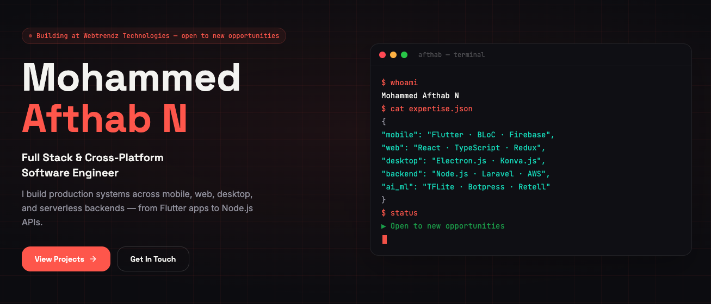

  

  <h3>Software Engineer · Flutter & React/TypeScript · Offline-first mobile systems</h3>

  
  
  
  <!-- Add your email so recruiters can reach you in one click: -->
  <!--  -->

---

## 👋 About me

I build cross-platform mobile apps in **Flutter** and frontends in **React + TypeScript**, with Laravel, Node.js and Firebase on the backend. I've been shipping production software at **Webtrendz Technologies** since 2024.

- 🔭 **Right now:** building end-to-end apps across mobile, web and backend
- 🧱 **How I work:** architecture first (BLoC, SOLID, Clean Architecture), pixel-accurate UI, and apps that keep working offline
- 🎓 **B.Tech, Computer Science & Engineering**, SRM Institute (CGPA 9.38)
- 🧠 Published research on EEG-based emotion classification with deep learning

---

## 🚀 Featured work

| Project | Stack | What I built |
|---|---|---|
| **💰 WT Books** | Flutter · Node.js · Hive · Firestore | Offline-first financial ledger. Local writes go to Hive; a background delta-sync pushes changes to Firestore and resolves conflicts when the connection returns. |
| **🛥️ Docklyne** | Flutter · Firebase | Cross-platform boat marketplace with 72,000+ listings, dynamic pricing and fleet management, built to stay smooth at that catalogue size. |
| **🎓 Thiruvel Academy** | React · TypeScript · Laravel · Firebase | Multi-tenant education dashboard on Clean Architecture, with Zod-validated forms and passwordless sign-in so students can start exams without friction. |

<!-- Tip: link each project name to its repo, live demo or case study, e.g. [**WT Books**](https://github.com/MohammedAfthab18/wt-books) -->

---

## 🛠️ Tech stack

**Mobile**  

**Frontend**  

**Backend & data**  

**Tools**  

---

## 📜 Research & certifications

**🧠 Publication**
**[EEG Based Emotion Classification using Deep Learning Models](https://www.researchgate.net/publication/375668956_EEG_Based_Emotion_Classification_using_Deep_Learning_Models)** — *IJISRT, Nov 2023*
Benchmarked DNN, GRU and LSTM models for classifying emotions from EEG signals, compared with confusion-matrix evaluation.

**🏆 Certifications** — Machine Learning Specialization (Stanford University & DeepLearning.AI, Coursera)
- Supervised Machine Learning: Regression and Classification
- Advanced Learning Algorithms
- Unsupervised Learning, Recommenders, Reinforcement Learning

---

## 📊 GitHub activity

  

<picture>
  <source media="(prefers-color-scheme: dark)" srcset="https://raw.githubusercontent.com/MohammedAfthab18/MohammedAfthab18/output/github-contribution-grid-snake-dark.svg">
  <source media="(prefers-color-scheme: light)" srcset="https://raw.githubusercontent.com/MohammedAfthab18/MohammedAfthab18/output/github-contribution-grid-snake.svg">
  
</picture>

---

  <b>Open to Flutter and frontend roles — let's build something solid.</b> 
  <a href="https://www.linkedin.com/in/mohammed-afthab-4a8a72220/">Reach me on LinkedIn</a>

